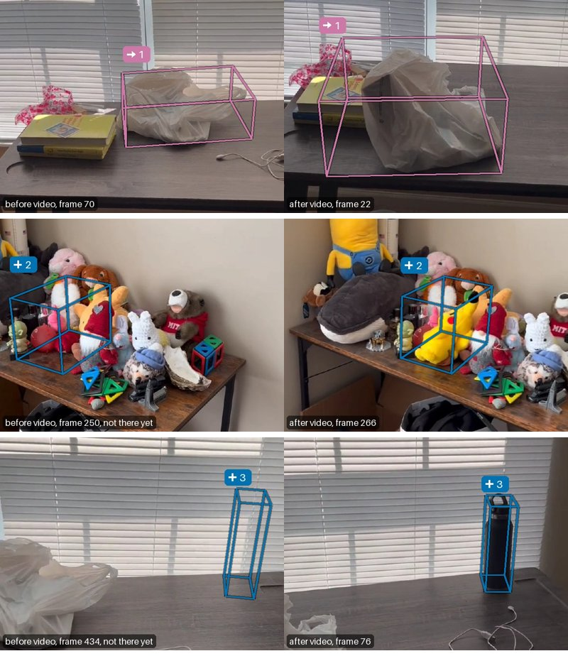

# roomdiff

Compare two phone videos of the same room and find, in 3D, what was moved, added or removed. Every verdict comes with the evidence behind it, and what one video could not check is reported as such instead of being called a change.


*The before scene with the confirmed edits applied, from 0 to 100 %: the cushion travels 1.6 m along the sofa and settles as the after video saw it; the stool and the top fold of the coat disappear.*

## See the results without installing

- 3D viewers: [living room](docs/living_room.html) and [bedroom](docs/bedroom.html). Each is one self-contained HTML file that works offline. GitHub shows it as source, so download it and open it in a browser, or serve `/docs` with GitHub Pages, whose root opens the living room.
- Living room: [report](examples/living_room/output/report.md), [changes.json](examples/living_room/output/changes.json), input videos [before](examples/living_room/before.mp4) and [after](examples/living_room/after.mp4).
- Bedroom (with additions): [report](examples/bedroom/output/report.md), [changes.json](examples/bedroom/output/changes.json), [before](examples/bedroom/before.mp4), [after](examples/bedroom/after.mp4).


Evidence cards: each change's 3D box drawn into the best before frame and the best after frame; for a move, the old box in the before frame and the new one in the after frame.




Both examples are SceneDiff pairs (living_room_17/18 and bedroom_32/33, MIT): they come with ground truth, so this paragraph can say what was missed. In the living room the ground truth lists 7 changes. roomdiff reports 4, all real: the cushion, the stool, the coat (named only "possibly a blanket", and boxed only where it lay on the backrest) and a 5 cm tote bag. The bag is left unverified, because the after video looked through 38 % of it and could not tell the rest from the seat under it; its sentence also gets both nouns wrong ("the beige shoe on the shelf"), and the bag in fact moved: its new place was not found, so it reads as a possible removal. roomdiff misses the bread (6 cm tall, too few free points), the tissue box (the before video never looked through its place) and the remote (1 cm). In the bedroom it reports 3 of 4, calls the small table under the stuffed animal a shelf, and misses a cable lying flat on the desk.


On the living-room pair, 29 regions have no point of the other video within 5 cm, and nearest-neighbour differencing would report each one as a change. The other video looked through 6 of them, and 5 of those make up the 4 reported changes. It had 10 hidden behind nearer surfaces, saw 10 in fewer than three frames, and saw a surface at the other 3. In the bedroom: 25 regions, 3 looked through, 3 changes.

## Quickstart

```bash
uv sync
uv run roomdiff run examples/living_room/before.mp4 examples/living_room/after.mp4 --out runs/demo
open runs/demo/viewer.html   # xdg-open on Linux
```

The device is chosen in the order CUDA, Apple Silicon (MPS), CPU. On an M2 Max with 32 GB a pair of 12 s videos takes 3 to 4 minutes (75 to 120 s of it the reconstruction; a second run of the pair takes under 1 minute) and peaks at 12 GB of GPU memory; on a 16 GB Mac add `--config.frames-per-video 16`. The first run downloads about 10 GB of model weights. CUDA is supported in the code but was not tested (no NVIDIA GPU here); the locked PyTorch 2.14.1 needs NVIDIA driver 580 or newer on Linux, and its Windows wheel runs on the CPU only. The CPU works but is slow: with 8 keyframes per video the reconstruction took 107 s and the labels 53 s.

If `uv run` stops with `No module named 'roomdiff'` on a Mac, a folder sync has set the hidden flag on the venv's `.pth` files, which Python then skips: `chflags nohidden .venv/lib/python3*/site-packages/*.pth`. Reconstructions are cached in `./cache` (about 28 MB per pair), so a second run of a pair skips Pi3X.

The output folder holds `changes.json`, `viewer.html` (3D viewer with an edit slider), `floorplan.png`, `report.md` with evidence cards, and `scene.ply`. The terminal prints one sentence per change at the end.

- `changes.json`: one record per change with `id`, `type` (moved, added, removed), `status` (confirmed or unverified), `reason`, `label` and `label_score`, `title` (the label, hedged as "possibly a ..." below 0.35), `sentence`, `box_before` and `box_after` (centre, size along the box's own x and y and world z, `yaw` in radians about z), `motion` (distance, turn when measurable, fit, `in_place` for a turn without a move), `transform` (maps the object's before points onto its after points, p_after = Rz(yaw) p_before + t; the boxes are fitted separately, so their centres can differ from the mapped centre by a few cm), `support`, `height_m`, `floor_blocked_m2`, `check_from` (where to film again, for an unverified removal), `evidence` (shares of the object's points above its contact zone that the other video looked through, saw as a surface, had hidden, or saw in fewer than 3 frames) and `cards`. Top-level `frame` states the axes: one metric frame for both videos, new for each run, z up, x along one of the main wall directions, and the floor at z = 0 when `floor_found` is true. `camera_height_m`, `counts`, `coverage`, `ledger` and `warnings` describe the run.
- `scene.ply`: both point clouds in that frame, with per point the video, the change id (-1 unchanged) and the evidence state against the other video (0 surface seen, 1 looked through, 2 hidden, 3 too few views).

## How it works


1. **One shared 3D frame.** Keyframes of both videos go through one Pi3X pass, which returns depth and a camera pose for every frame in one metric frame. Gravity comes from the cameras (handheld phones keep roll near zero), or from surface normals when the cameras barely turned (2 of the 18 report pairs). The floor is set to z = 0; where no floor lies 0.9 to 2.2 m below the cameras (2 pairs, filmed over a bed and a desk), z = 0 is the lowest large level surface and nothing is said to be on the floor.
2. **Change needs evidence.** Every surface point the before video saw is projected into every after frame. If most of at least three after frames saw farther along that ray, they looked through the place where the surface used to be: the point is *free* (looked through), evidence of absence. If the depth agrees, it is *seen*. If something nearer blocked the ray, the point is *occluded* (hidden); if fewer than three after frames gave an answer, *unreached* (too few views). Neither of the last two says anything about change. The same test runs from after to before for additions. Only free points can start a change, and a group of them counts only if cameras in two or more places 25 cm apart looked through it.
3. **Objects and verdicts.** Each candidate becomes an object: SAM 2.1 segments it in the views that see it best, and the masks are lifted to 3D. Its verdict comes from its points above the contact zone. It is *confirmed* when the other video looked through at least half of the points it could check, *dismissed* below a fifth, and *unverified* in between, with the reason: partly still there, or too flat to tell from the surface under it. An object the other video could check less than a fifth of would be unverified as hidden or seen too rarely, and a removal would get the pose to film from again; since every candidate starts from free points, this never happened on the 18 report pairs. Points nobody checked are tinted in the viewer; the top view tints places where every point was seen too rarely.
4. **Moves.** A disappeared and an appeared object that look alike (DINOv2 features) are matched, and a rigid fit gives the distance and the turn. When a confirmed removal or addition has no partner, the best appearance match in the other video is used, but only if the first video saw that place empty: where the first video never looked, appearance alone cannot tell the moved object from an unchanged twin. Only the single best match is tried.
5. **Words from geometry.** The support is found in 3D (the static points under the object) and named by SigLIP 2 from a crop of it; SigLIP 2 also names the object from its masked crops, and the colour comes from the masked pixels. Height, distance, turn and blocked floor area come from the 3D points, and the floor is only ever named by geometry. No language model decides what changed.

## Results

Report set: 18 indoor test pairs of the [SceneDiff benchmark](https://huggingface.co/datasets/yuqun/SceneDiff), with 50 changed objects (15 of them lower than 8 cm). In the 3D scores, a change matches a ground-truth object (lifted into 3D with the run's own depth) when a quarter of its points lie within 5 cm of it, one-to-one.

| | roomdiff | naive differencing |
|---|---|---|
| changes reported | 54 (42 confirmed) | 435 |
| recall, all objects | 0.62 | 0.72 |
| recall, objects 8 cm or taller (35) | 0.77 | 0.94 |
| precision | 0.57 (confirmed only: 0.62) | 0.08 |
| false changes where the other video saw too little to check | 1 | 183 |
| correct type (moved, added, removed) among found | 0.61 | 0.47 |
| ground-truth moves (27) found as moves; of those, both ends on the object; median distance error | 8; 7; 0.06 m | none |
| moves reported | 16 | none |
| unchanged room: changes reported on 6 half-video controls | 0 | 37 |
| static background seen through (false-free rate), mean / median | 1.2 % / 0.2 % | |
| SceneDiff official: px/im IoU, obj/im AP, obj/sc AP | 42.7, 28.0, 15.7 | |
| SceneDiff official at mask IoU 0.5: objects found, false detections | 16 of 50, 37 | |

Naive differencing calls a point changed when the other cloud has nothing within 5 cm, after the same joint reconstruction (as in VGGT-CD), with the same clustering. It finds more objects, but 183 of its 435 changes lie where the other video saw too little to check. The half-video controls cut one video in two: the same unchanged room, filmed along two stretches that overlap by 8 to 84 %. The official SceneDiff evaluator was run on masks exported for the same 18 pairs; it counts an object only where the 2D masks reach IoU 0.5 in the scored frames, so 15 of the 31 objects found in 3D do not count there. SceneDiff reports 39.1, 43.8 and 22.8 on its full SD-V test set ([arXiv 2512.16908](https://arxiv.org/abs/2512.16908)), so the numbers are not directly comparable.

Of the 12 type errors among the 31 found objects, 10 are moves read as a removal or an addition. In 8 one end was found and the other was not: the other video filmed it from one place only or never, or the found end was only partly confirmed, and partial objects are not searched for. In 2 (office_1, lounge_11) roomdiff reported the move whole, but the one-to-one match credited a smaller added fragment of the same object. The other 2 are a removal or an addition paired with a similar object. Accepting a search match only where the first video saw the place empty lowered this score from 0.71 to 0.61 on the report pairs: the 3 moves found at places the first video never filmed had the right type, but in 2 of them one end lay on a different object. Without the search it is 0.45.

Detection thresholds were set on 4 validation pairs (living_room_1_2, bedroom_2_4, lounge_1_2, living_room_35_36) and the living room example, never on the report pairs. The labeller (model, prompts, crop and hedge thresholds) was chosen on ground-truth crops from all 23 pairs (80 objects), report pairs included, with a vocabulary that holds every SceneDiff label, so its 87.5 % top-1 on those crops is optimistic. The worst false-free rate is study_1_study_2 (7 % and 19 %): its two videos share one corner of the room, and two walls of the before reconstruction do not line up with the after video.

**Reproducing the numbers.** Download `scenediff_benchmark.zip` (11.9 GB) from the dataset page and unpack it so that `data/scenediff_benchmark/data/<pair>/` and `data/scenediff_benchmark/splits/` exist. `uv run python scripts/evaluate.py --set report --official` writes the 3D scores and `object_masks.pkl` per pair to `runs/eval` (about 3 minutes per pair on an M2 Max), and `--control --pairs lounge_1_lounge_2 living_room_1_living_room_2 living_room_13_living_room_14 bedroom_6_bedroom_7 office_1_office_2 study_1_study_2` runs the six half-video controls (2 validation pairs, 4 report pairs). For the official metrics, clone SceneDiff's code next to this repository (`git clone https://github.com/yuqunw/scene_diff ../scene_diff`, tested at commit 62dcbd2) and run from this repository's root: `uv run --with faiss-cpu --with pycocotools --with opencv-python-headless --with matplotlib python ../scene_diff/scripts/evaluate_multiview.py --pred_dir runs/eval/official --output_path runs/eval/official_result.txt`.

## Using your own videos

Record two videos of the same room, 10 to 20 s each, in the same light, and move, add or remove a few objects in between.

- 1x lens, 1080p, landscape in both videos (a portrait and a landscape video are cropped to one shape). Turn off HDR Video and turn on Lock Camera and Lock White Balance in Settings, Camera, Record Video; press and hold on the screen to lock exposure and focus.
- Change objects at least 10 cm tall (objects under 8 cm were found 27 % of the time) within a few metres of the camera; anything seen from farther than 6 m is ignored. Move a piece of furniture clear of its old footprint: a chair moved by less than its own size can split into several changes.
- Walk at least 1 m sideways in each video with the camera facing into the room, and pass every spot that changes, including where a removed object stood and both ends of a move: free space counts only where cameras in two places at least 25 cm apart looked through it. Do not pivot on the spot. Keep some floor in view.
- Film the second video along a different path, but cover the same objects. Keep people and mirrors out of view. Measure one move with a tape to check the reported distance.
- `uv run roomdiff run before.MOV after.MOV --out runs/mine`. iPhone `.MOV` files (HEVC, rotated) work directly. Every result here used the default of 28 keyframes per video, on clips of 5 to 20 s; for longer videos add `--config.frames-per-video 40` (80 frames take 2 minutes and 14 GB of GPU memory on the M2 Max).
- To make your pair the main example: `uv run playwright install chromium` once, then `uv run python scripts/make_example.py before.MOV after.MOV --name my_room` (it takes the same `--config` flags). It analyses 1280 px H.264 copies saved as `examples/my_room/before.mp4` and `after.mp4`, so its changes can differ slightly from a run on the .MOV files. It writes `examples/my_room/output`, the viewer `docs/my_room.html` (opened by `docs/index.html`), the GIF, the top view and the evidence figure. By hand: the viewer and example links, the card-strip image, the GIF caption, and the two paragraphs under the cards and under the evidence figure.

## Limitations

- Objects lower than about 8 cm (remotes, phones, books, cables) sit inside the depth band (4 cm plus 3 % of the depth, about 10 cm at 2 m) and are rarely found: 27 % recall on the report set, against 77 % for taller objects.
- A video whose camera moved less than about 1 m loses changes to the two-viewpoint rule: on the report pairs it dropped a paper bag, a pillow and a water bottle that the other video had looked through, and the new place of a chair, which then reads as removed.
- Rigid furniture moved by less than its own size and deformable objects (curtains, blankets, clothes) are often split: 9 of the 23 unmatched changes on the report set are pieces of changed objects.
- Scale comes from Pi3X and was not measured here (image-only models are reported at about 15 % scale error); the sentences round distances to 0.1 m, changes.json keeps 0.01 m.
- The turn of a moved object is reported only when the rigid fit is unambiguous; the viewer's slider still turns the object by the fitted yaw (`transform`), which can then be off by the spread of the good fits.
- Labels come from a closed vocabulary of 260 indoor objects; names scored below 0.35 are hedged, and a confident name or a support name can still be wrong (the tote bag and the bedroom's stuffed animal above).
- When the two videos share little of the room, the joint reconstruction can misalign walls (study_1_study_2). Mirrors and windows can create spurious geometry.

## Credits and licences

The code in this repository is MIT. Model weights are downloaded at run time from Hugging Face, each pinned to a revision:

| Model | Use | Licence |
|---|---|---|
| Pi3X (yyfz233/Pi3X) | joint reconstruction | weights CC BY-NC 4.0 (non-commercial), code BSD-3 |
| SAM 2.1 hiera-base-plus | object masks | Apache-2.0 |
| DINOv2 base | matching moved objects | Apache-2.0 |
| SigLIP 2 large (patch16-384) | labels | Apache-2.0 |
| three.js r147 (bundled) | viewer | MIT |

Example videos: SceneDiff benchmark (Wu et al., arXiv 2512.16908), MIT. The ray test follows SceneDiff's `foreground_distance`, Khronos (Schmid et al., RSS 2024) and Fehr et al. (ICRA 2017). [DESIGN.md](DESIGN.md) explains the design choices.
