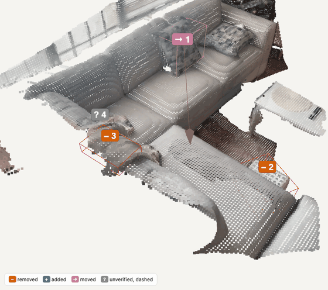
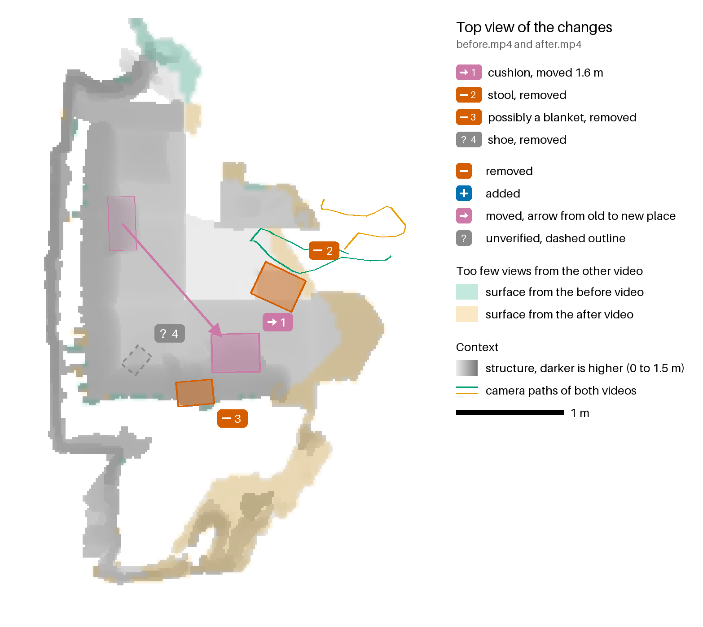
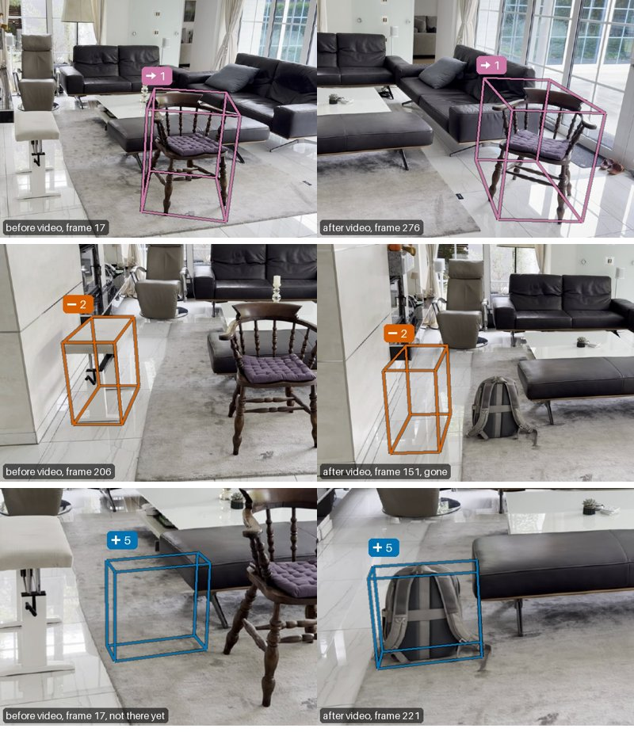
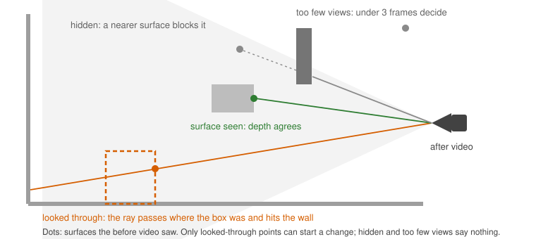
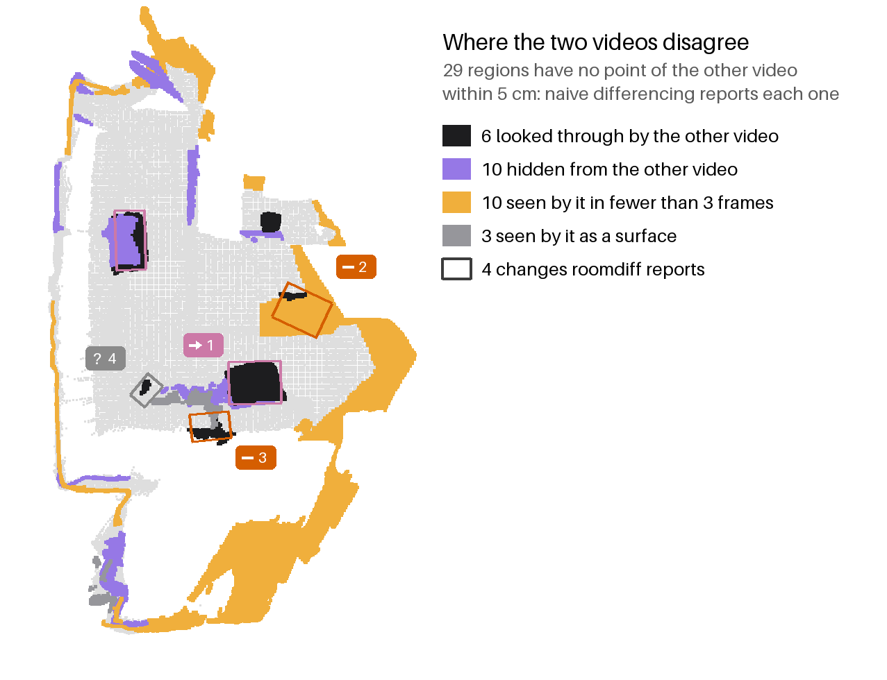

# roomdiff

roomdiff compares two phone videos of a room and shows in 3D what was moved, added or removed. It reports a change only where the other video looked through the spot. Places it could not check are marked as not checked.



*Own iPhone recording: the detected changes applied to the before scene. The chair moves 1.6 m and turns, the stool and the candle holder disappear, and a backpack appears. Tags 4 and 6 are false (see below).*

## Examples

- 3D viewer: [my room](docs/my_room.html), [living room](docs/living_room.html), [bedroom](docs/bedroom.html). Download and open in a browser, or serve `docs/` with GitHub Pages.
- Report: [my room](examples/my_room/output/report.md), [living room](examples/living_room/output/report.md), [bedroom](examples/bedroom/output/report.md).





The main example is a pair of 16 s iPhone videos filmed for this project. Between them a chair was moved and turned, a stool and a 40 cm candle holder were taken away, and a backpack was put on the floor. roomdiff finds all four with the right type. It also reports two changes that did not happen: the chair's reflection in the glass door next to its new place, and a small cluster of 20 points.

The other two examples come from the SceneDiff benchmark, so the misses are known. In the living room roomdiff finds 4 of 7 changes. It misses a loaf of bread, a tissue box and a remote, and calls a tote bag a slipper. In the bedroom it finds 3 of 4 and misses a flat cable.

## Quickstart

```bash
uv sync
uv run roomdiff run examples/my_room/before.mp4 examples/my_room/after.mp4 --out runs/demo
open runs/demo/viewer.html
```

Tested on Apple Silicon. CUDA is supported but untested, and the CPU is slow. The first run downloads about 10 GB of model weights. After that a pair takes 2.5 to 4 minutes on an M2 Max.

The output folder holds `viewer.html`, `report.md`, `floorplan.png`, `changes.json` and `scene.ply`. `changes.json` has one record per change: type, status, reason, sentence, 3D boxes, the move transform and the evidence behind it. `scene.ply` holds both point clouds with a change id and an evidence state per point.

## How it works



1. **One 3D frame.** Pi3X reconstructs the keyframes of both videos in one pass, with depth and camera poses in one metric frame, z up.
2. **Evidence of absence.** Each surface point of the before video is tested against the after frames. If the after camera saw past it, the point is free. If something closer blocked the view, it is hidden, and if fewer than three frames saw it, it has too few views. Both count as not checked. Only free points can start a change. The same test runs in reverse for additions.
3. **Objects.** SAM 2.1 turns each group of free points into an object. It is confirmed when the other video looked through at least half of the points it could check, and dropped when it looked through less than a fifth. Otherwise it is reported as unverified, with the reason.
4. **Moves.** A removed and an added object that look alike (DINOv2) and fit with a rigid transform become one move with a distance and a turn.
5. **Words.** SigLIP 2 names the object and what it stands on. Heights, distances and colours are measured. No language model decides what changed.

## Results

18 test pairs of the [SceneDiff benchmark](https://huggingface.co/datasets/yuqun/SceneDiff) with 50 changed objects. The baseline marks every point that has no point of the other video within 5 cm.

| | roomdiff | baseline |
|---|---|---|
| changes reported | 54 | 435 |
| recall, all (8 cm or taller) | 0.62 (0.77) | 0.72 (0.94) |
| precision | 0.57 | 0.08 |
| false changes where the other video saw too little | 1 | 183 |
| correct type (moved, added, removed) | 0.61 | 0.47 |
| changes between two halves of one video (6 unchanged rooms) | 0 | 37 |
| SceneDiff metrics: px/im IoU, obj/im AP, obj/sc AP | 42.7, 28.0, 15.7 | |

Thresholds were set on 4 other SceneDiff pairs (living_room_1_2, bedroom_2_4, lounge_1_2, living_room_35_36) and on the living-room example. The figure shows why the baseline reports so much on the main example: of its 51 regions, the other video looked through only 5, and those make up the 4 real changes.



[DESIGN.md](DESIGN.md) explains the design choices, gives more numbers and lists the commands that reproduce the table.

## Your own videos

- Film two videos of the same room, 10 to 20 s each, in the same light. Use landscape, turn HDR Video off if the phone offers it, and lock exposure.
- Walk at least 1 m sideways instead of turning on the spot, and pass every place that changes. Film the second video along a slightly different path.
- Change objects at least 10 cm tall.
- Run `uv run roomdiff run before.MOV after.MOV --out runs/mine`.

`scripts/make_example.py` turns a pair into a committed example and rebuilds the media above.

## Limitations

- Objects under 8 cm are mostly missed (27 % recall).
- Free space must be seen from two places, so a camera that hardly moves loses changes.
- Soft objects and furniture moved less than its own size can split into several changes.
- Names come from SigLIP 2 and can be wrong. Scale comes from Pi3X and was not measured.

## Credits and licences

Code: MIT. Model weights are downloaded at run time, each pinned to a revision.

| Model | Use | Licence |
|---|---|---|
| Pi3X | reconstruction | weights CC BY-NC 4.0 (non-commercial), code BSD-3 |
| SAM 2.1 base-plus | object masks | Apache-2.0 |
| DINOv2 base | matching moves | Apache-2.0 |
| SigLIP 2 large | names | Apache-2.0 |
| three.js r147 | viewer | MIT |

Example videos: my_room was filmed for this project; living_room and bedroom come from SceneDiff (Wu et al., arXiv 2512.16908), MIT. The ray test follows SceneDiff's `foreground_distance` and Khronos (Schmid et al., RSS 2024).
