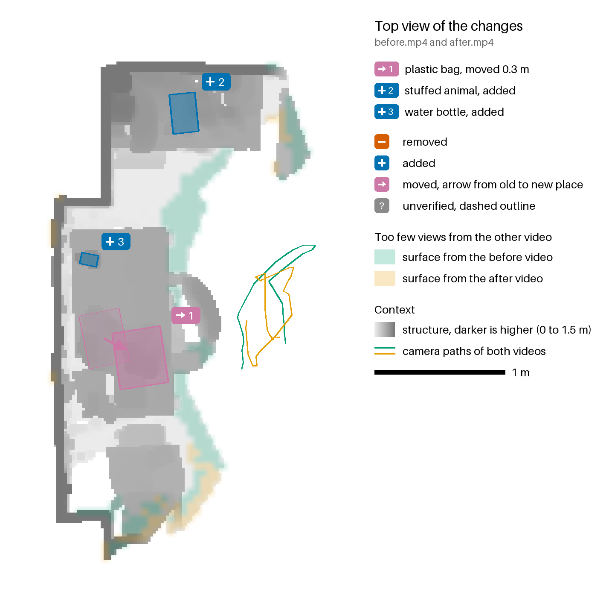
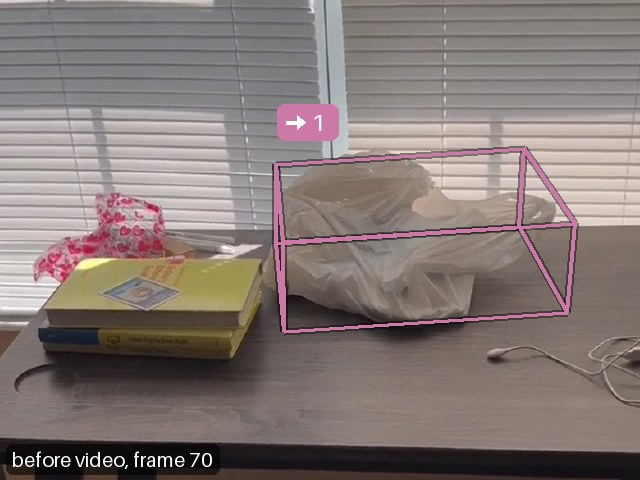
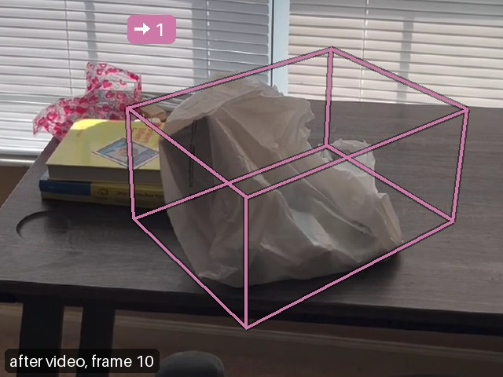
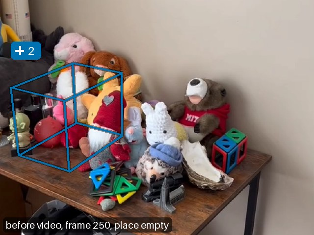
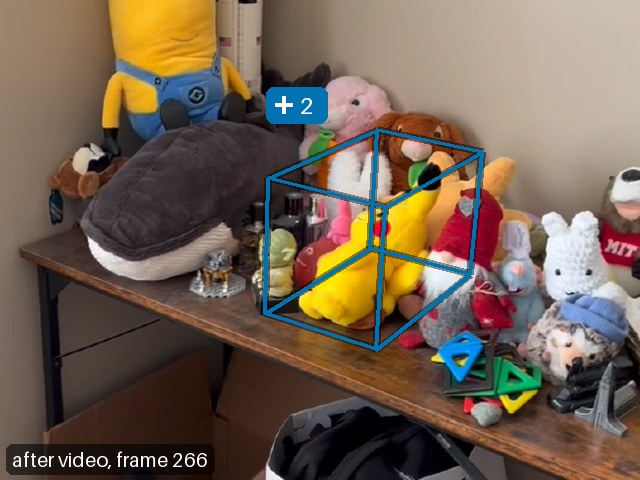
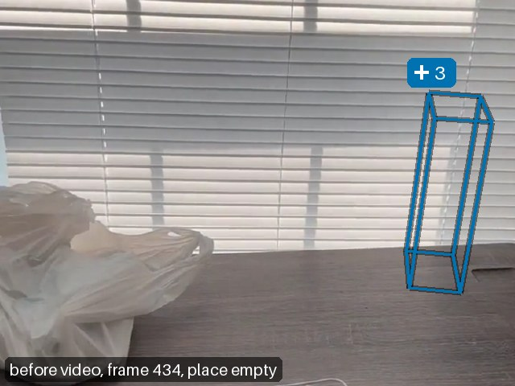
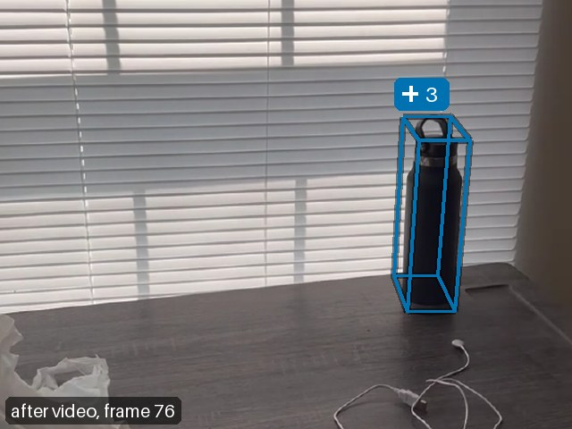

# What changed in the room

Between before.mp4 and after.mp4 roomdiff found 3 changes: 1 moved, 2 added.
The camera was held 1.53 m above the floor. Boxes and positions are in changes.json; its "frame" field gives the axes.

| id | | type | name | status | sentence |
|---|---|---|---|---|---|
| 1 | → | moved | plastic bag | confirmed | The plastic bag moved 0.3 m along the desk. |
| 2 | + | added | stuffed animal | confirmed | A yellow stuffed animal appeared on the shelf (84 cm up). |
| 3 | + | added | water bottle | confirmed | A black water bottle appeared on the desk (85 cm up). |

## → 1: plastic bag, moved

The plastic bag moved 0.3 m along the desk.

- Status: confirmed (the after video looked through 97 % of the points it could check).
- Motion: 0.33 m.
- Evidence: 517 points: 64 % looked through, 2 % surface seen, 14 % hidden, 21 % too few views.

 

## + 2: stuffed animal, added

A yellow stuffed animal appeared on the shelf (84 cm up).

- Status: confirmed (the before video looked through 64 % of the points it could check).
- Evidence: 232 points: 61 % looked through, 34 % surface seen, 5 % too few views.

 

## + 3: water bottle, added

A black water bottle appeared on the desk (85 cm up).

- Status: confirmed (the before video looked through 100 % of the points it could check).
- Evidence: 135 points: 100 % looked through.

 

## Coverage

The other video checked 72 % of all surface points; 10 % were hidden from it. The other video saw the rest in fewer than three frames: 10 % from the before video and 8 % from the after video. The viewer tints them and the hidden points; the top view tints places where nothing was checked.

The points the other video looked through belong to: 96 % confirmed changes and 4 % no candidate.

## Method

Both videos were reconstructed in one pass into a shared metric frame with z up. A surface counts as removed
or added only where the other video looked through the place it occupied. Each change keeps the share of its
points that the other video looked through, saw as a surface, had hidden behind something nearer, or saw in
fewer than three frames (too few views).
