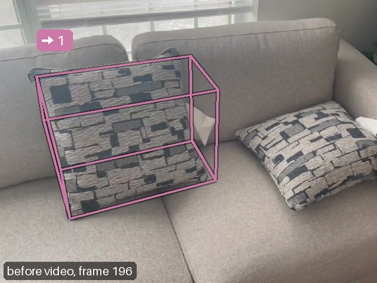
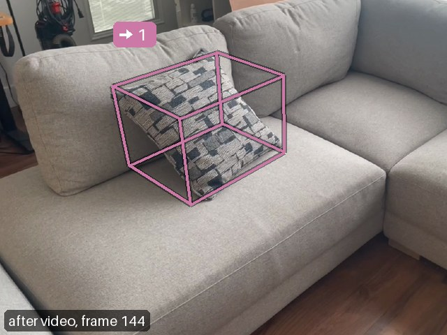
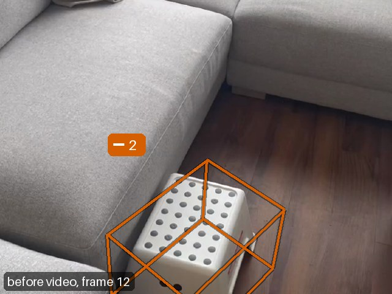
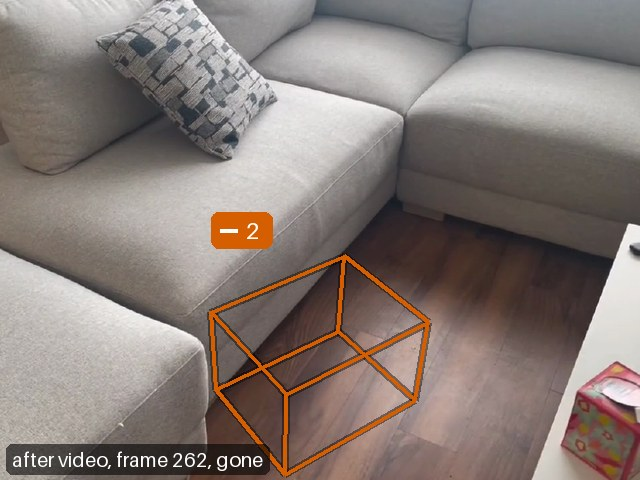
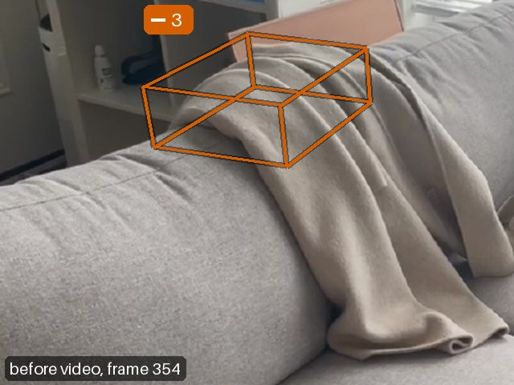
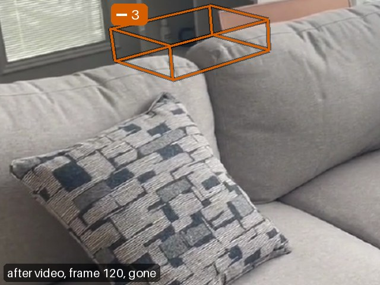
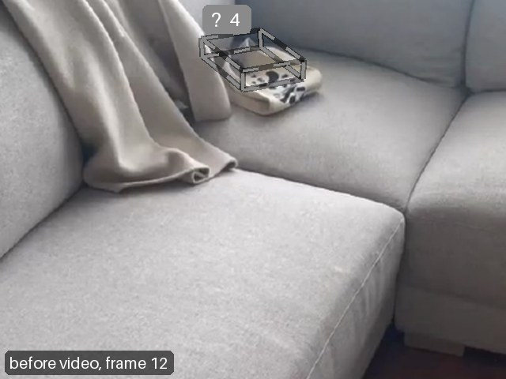
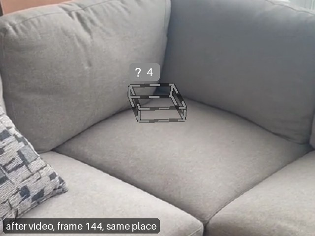

# What changed in the room

Between before.mp4 and after.mp4 roomdiff found 4 changes: 1 moved, 3 removed; 1 of them unverified.
Unverified means not enough evidence either way: the other video saw too little of it, part of it is still there, or it is too flat to tell from the surface under it.
The camera was held 1.49 m above the floor. Boxes and positions are in changes.json; its "frame" field gives the axes.

| id | | type | label | status | sentence |
|---|---|---|---|---|---|
| 1 | → | moved | cushion | confirmed | The grey cushion moved 1.6 m along the sofa. |
| 2 | − | removed | stool | confirmed | The white stool on the floor was removed. |
| 3 | − | removed | possibly a blanket | confirmed | The object on the sofa (83 cm up), possibly a blanket, was removed. |
| 4 | ? | removed | shoe | unverified | The beige shoe on the shelf (50 cm up) may have been removed. |

## → 1: cushion, moved

The grey cushion moved 1.6 m along the sofa.

- Status: confirmed (the after video looked through 70 % of the points it could check).
- Motion: 1.56 m.
- Evidence: 888 points: 70 % looked through, 30 % surface seen.

 

## − 2: stool, removed

The white stool on the floor was removed.

- Status: confirmed (the after video looked through 93 % of the points it could check).
- Evidence: 462 points: 92 % looked through, 7 % surface seen, 1 % too few views.

 

## − 3: possibly a blanket, removed

The object on the sofa (83 cm up), possibly a blanket, was removed.

- Status: confirmed (the after video looked through 87 % of the points it could check).
- Evidence: 221 points: 69 % looked through, 10 % surface seen, 20 % too few views.

 

## ? 4: shoe, removed

The beige shoe on the shelf (50 cm up) may have been removed.

- Status: unverified (the after video looked through 38 % of it; at 5 cm tall, the rest cannot be told apart from the surface under it).
- Evidence: 122 points: 38 % looked through, 62 % surface seen.

 

## Coverage

The other video checked 70 % of all surface points; 7 % were hidden from it. The other video saw the rest in fewer than three frames: 5 % from the before video and 17 % from the after video; the top view tints them.

The points the other video looked through belong to: 88 % confirmed changes, 2 % unverified changes, 8 % dismissed candidates and 3 % no candidate.

## Method

Both videos were reconstructed in one pass into a shared metric frame with z up. A surface counts as removed
or added only where the other video looked through the place it occupied. Each change keeps the share of its
points that the other video looked through, saw as a surface, had hidden behind something nearer, or saw in
fewer than three frames (too few views).
