# What changed in the room

Between before.mp4 and after.mp4 roomdiff found 6 changes: 1 moved, 2 added, 3 removed.
The camera was held 1.27 m above the floor. Positions and boxes are in changes.json.

Warning: before.mp4 is HDR video; record with HDR Video off for true colours.

Warning: after.mp4 is HDR video; record with HDR Video off for true colours.

Warning: both videos look in almost one direction; gravity comes from surface normals.

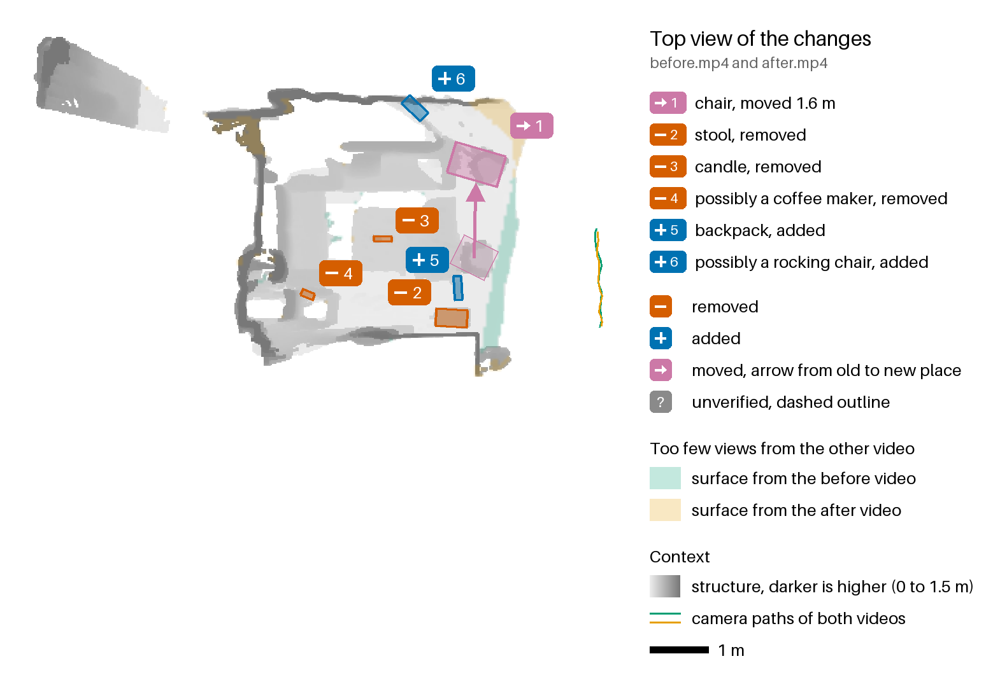

| id | | type | name | status | sentence |
|---|---|---|---|---|---|
| 1 | → | moved | chair | confirmed | The chair moved 1.6 m across the floor and turned about 50 degrees, blocking 0.48 m² of floor. |
| 2 | − | removed | stool | confirmed | The white stool on the floor was removed. |
| 3 | − | removed | candle | confirmed | The candle on the coffee table (29 cm up) was removed. |
| 4 | − | removed | possibly a coffee maker | confirmed | The object on the floor, possibly a coffee maker, was removed. |
| 5 | + | added | backpack | confirmed | A black backpack appeared on the floor, blocking 0.06 m² of floor. |
| 6 | + | added | possibly a rocking chair | confirmed | An object, possibly a rocking chair, appeared on the floor, blocking 0.09 m² of floor. |

## → 1: chair, moved

The chair moved 1.6 m across the floor and turned about 50 degrees, blocking 0.48 m² of floor.

- Status: confirmed (the after video looked through 95 % of the points it could check).
- Motion: 1.62 m, turned -51 degrees.
- Floor now blocked: 0.48 m².
- Evidence: 2,969 points: 89 % looked through, 5 % surface seen, 6 % too few views.

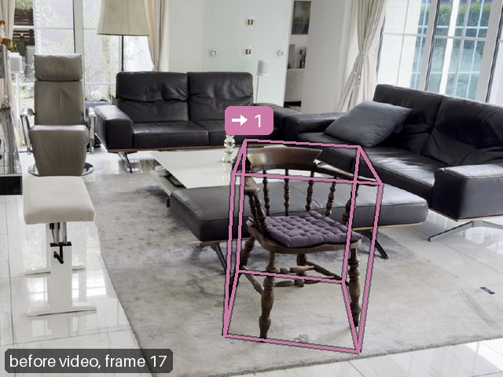 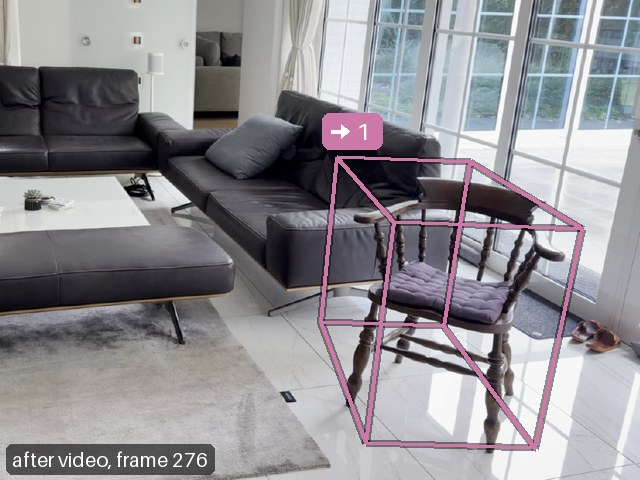

## − 2: stool, removed

The white stool on the floor was removed.

- Status: confirmed (the after video looked through 100 % of the points it could check).
- Evidence: 1,431 points: 99 % looked through, 1 % too few views.

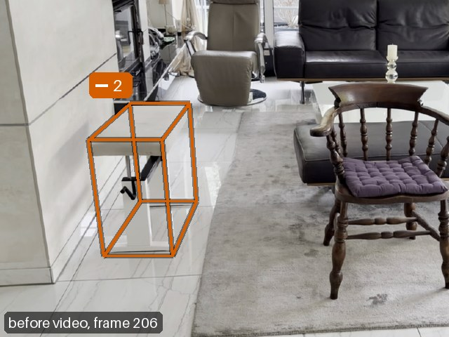 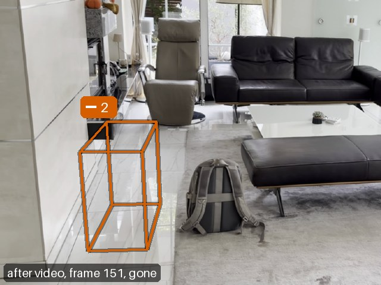

## − 3: candle, removed

The candle on the coffee table (29 cm up) was removed.

- Status: confirmed (the after video looked through 100 % of the points it could check).
- Evidence: 171 points: 91 % looked through, 9 % too few views.

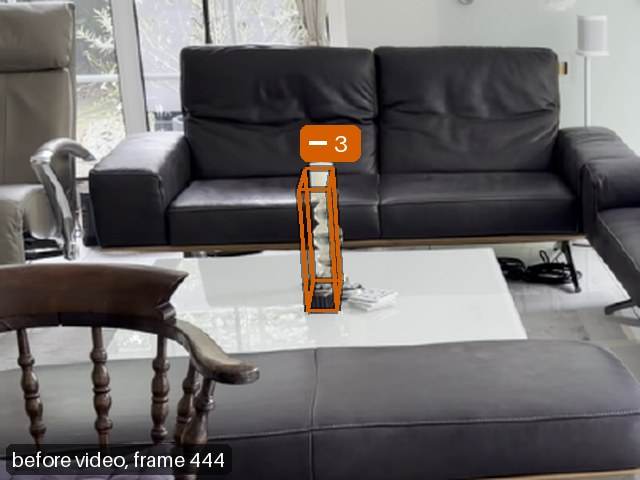 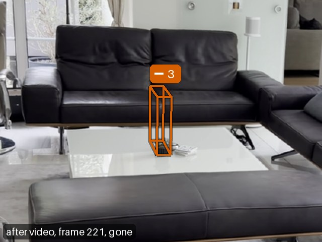

## − 4: possibly a coffee maker, removed

The object on the floor, possibly a coffee maker, was removed.

- Status: confirmed (the after video looked through 100 % of the points it could check).
- Evidence: 20 points: 100 % looked through.

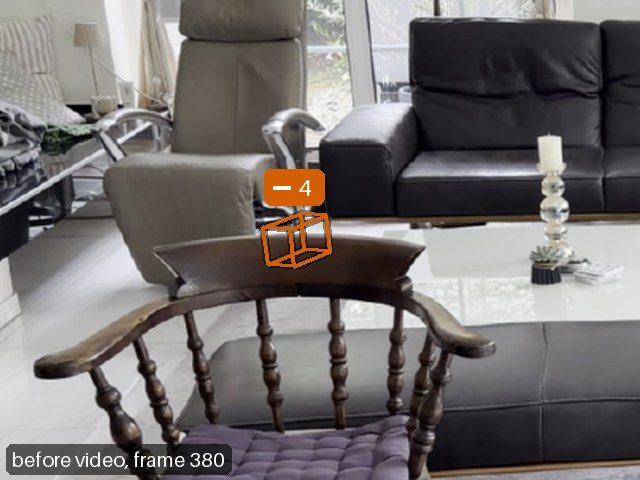 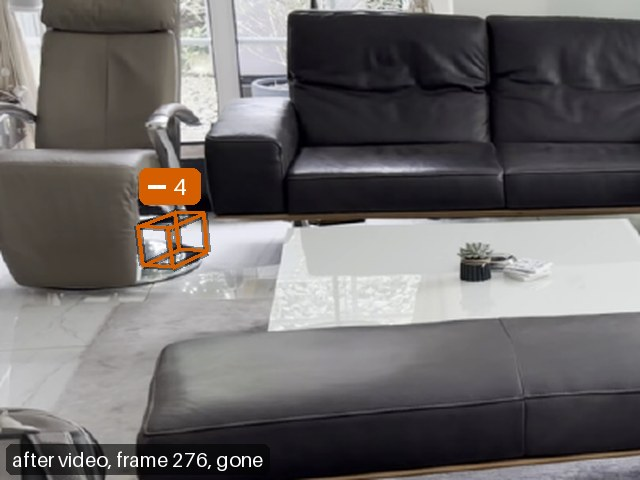

## + 5: backpack, added

A black backpack appeared on the floor, blocking 0.06 m² of floor.

- Status: confirmed (the before video looked through 100 % of the points it could check).
- Floor now blocked: 0.06 m².
- Evidence: 565 points: 100 % looked through.

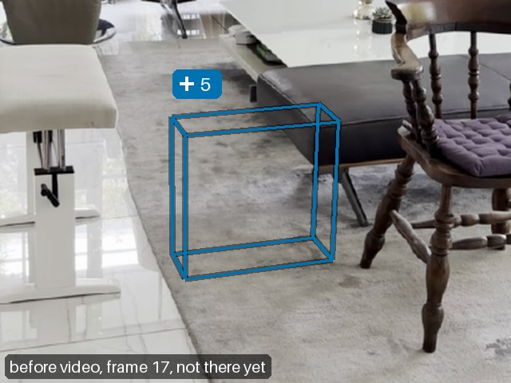 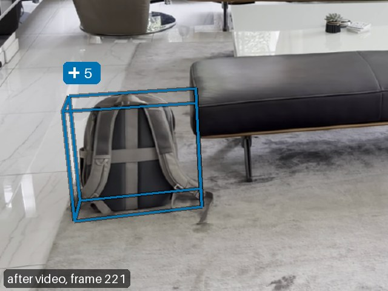

## + 6: possibly a rocking chair, added

An object, possibly a rocking chair, appeared on the floor, blocking 0.09 m² of floor.

- Status: confirmed (the before video looked through 60 % of the points it could check).
- Floor now blocked: 0.09 m².
- Evidence: 341 points: 57 % looked through, 38 % surface seen, 5 % too few views.

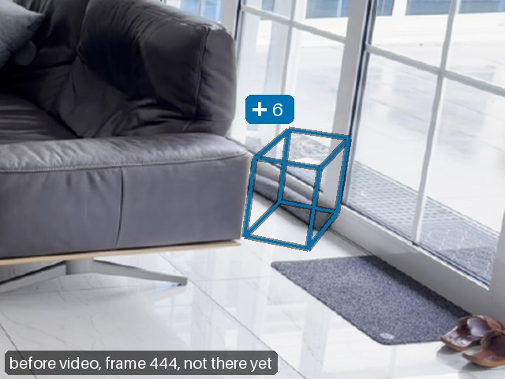 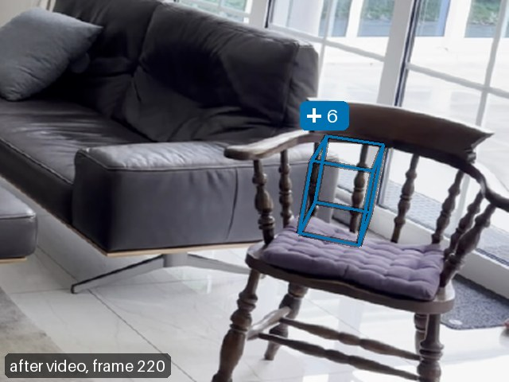

## Coverage

The other video checked 86 % of the surface points. It had 4 % hidden and saw 10 % in fewer than three frames; the viewer can tint both.

## Method

Both videos are reconstructed together in one metric frame. A surface counts as removed or added only where
the other video looked through the place it occupied. Each change lists how many of its points the other video
looked through, saw as a surface, had hidden, or saw too rarely to decide.
